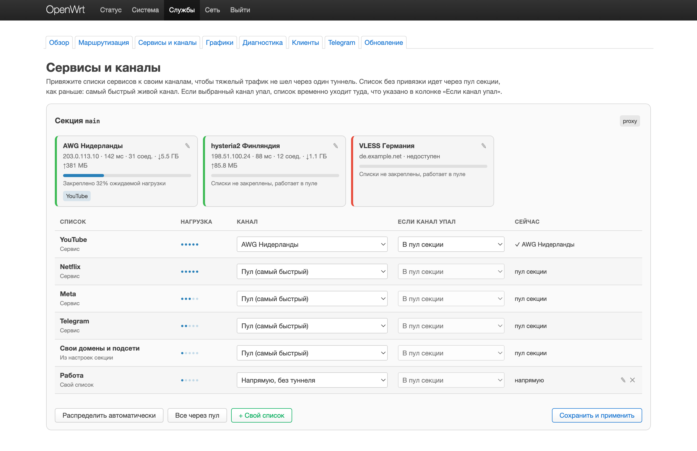
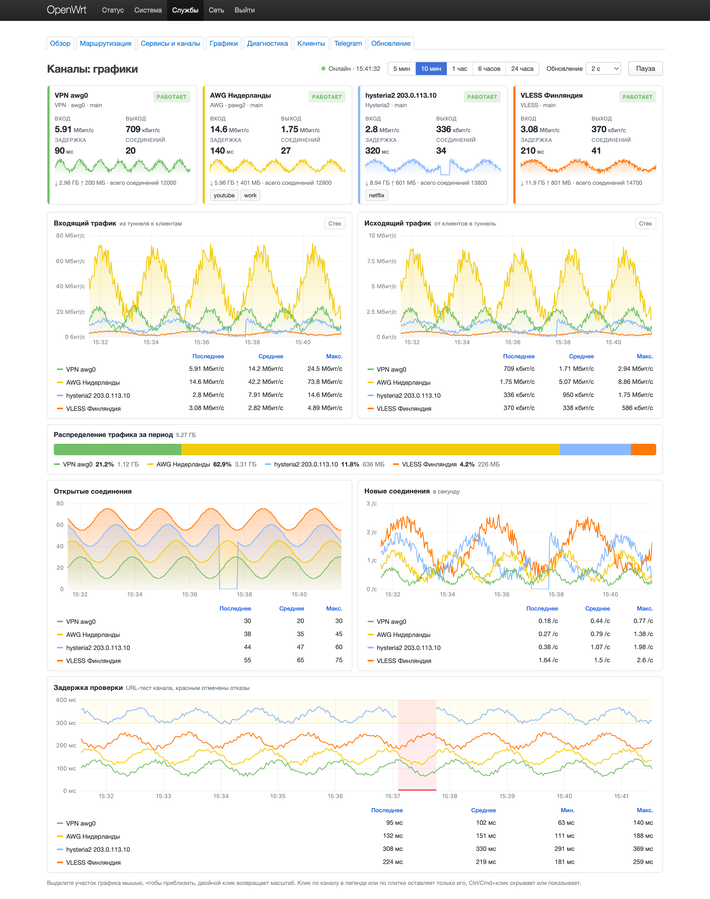
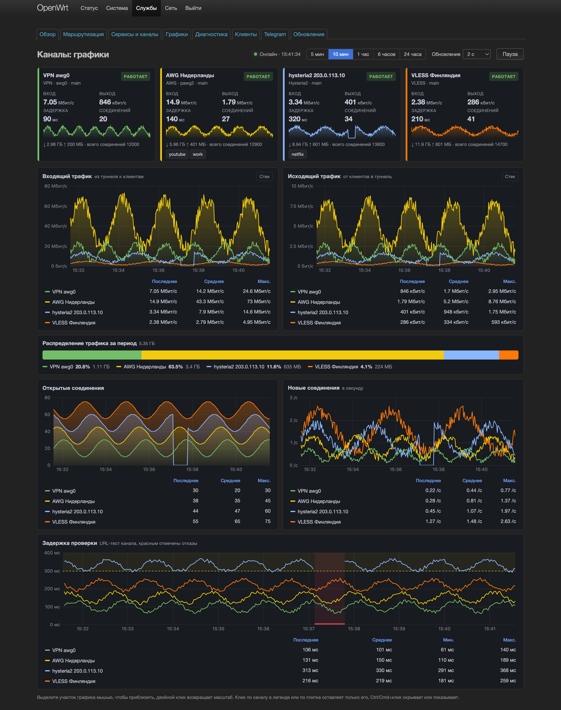

[English](en/LUCI.md)

# LuCI: руководство пользователя

Веб-интерфейс **`luci-app-hybrid-failover`** настраивает Hybrid Failover на роутере без ручной правки UCI.

**Меню:** Сервисы → Hybrid Failover  
**URL:** `http://ROUTER/cgi-bin/luci/admin/services/hybrid-failover`

Нужен установленный **`hybrid-failover-core`**. Если его нет или служба остановлена, страницы покажут "Нет данных" или ошибку.

Интерфейс написан на русском. Есть переводы на английский и упрощённый китайский (пакет `luci-i18n-hybrid-failover`), они включаются вместе с языком LuCI. В этом руководстве названия кнопок и полей даны так, как они выглядят на русском.

Как устроены страницы внутри (rpcd, ubus, сборка), описано в [luci/README.md](../luci/README.md).

---

## С чего начать

1. Установите пакеты по [INSTALL.md](INSTALL.md). Режим `full` ставит core, LuCI и бота. Скрипт установки сам выполняет `hybrid-failover migrate`, включает и запускает службу.
2. Откройте **Сервисы → Hybrid Failover**. Сразу откроется вкладка **Обзор**. Рядом с заголовком должно быть "Всё работает", а карточки Движок, Перехват трафика и DNS (fake-IP) должны показывать "работает" и "в порядке".
3. На вкладке **Маршрутизация** добавьте каналы (ссылки или подписку) и выберите, какие сервисы через них направлять.
4. Если нужно, добавьте правила на вкладке **Клиенты** (приставка, телевизор, рабочий ноутбук).

---

## Вкладки

| Вкладка | Для чего |
|---------|----------|
| **Обзор** | Живой статус: движок, перехват трафика, DNS, текущий канал, каналы с задержками, журнал переключений, ручное переключение |
| **Маршрутизация** | Общие настройки и секции маршрутизации: способ подключения, каналы, проверка каналов, списки сервисов, свои домены и подсети |
| **Сервисы и каналы** | Каналы секций с задержкой и нагрузкой, таблица «список → канал → если канал упал → сейчас», свои списки, автораспределение |
| **Графики** | Живые графики по каналам, обновление раз в 2 секунды |
| **Диагностика** | Полная проверка, отдельные проверки, резервная копия настроек |
| **Клиенты** | Правила для отдельных устройств по IP |
| **Telegram** | Настройки бота и автозапуск его службы |
| **Обновление** | Проверка новой версии на GitHub и установка релиза из LuCI |

---

## Обзор

Страница только показывает состояние, настройки здесь не меняются. Данные обновляются каждые 5 секунд. В шапке видно время последнего обновления, кнопка **Обновить** и селектор секции маршрутизации (он есть, только если секций больше одной).

Рядом с заголовком стоит общий статус.

| Статус | Когда |
|--------|-------|
| **Всё работает** | Движок запущен, правила перехвата на месте, DNS в порядке |
| **Есть предупреждения** | Основной VPN упал и трафик идёт через резерв, не прошла проверка DNS или core сообщил об ошибках |
| **Не работает** | Движок остановлен или правила перехвата трафика (nftables) не найдены |
| **Нет данных** | Не удалось получить состояние с роутера |

Там же видно, через какой канал идёт трафик сейчас, и версия core.

Под шапкой большой блок со статусом ("Трафик идёт через туннель", "Работает с предупреждениями" или "Туннель не работает") и ошибками, если они есть. Ниже четыре внутренние вкладки.

**Сводка.** Карточки Движок, Перехват трафика, DNS (fake-IP), Сейчас через, Каналы на связи (например `2 / 3`) и Режим с подсказкой, как он работает. Дальше карточки каналов секции с кнопкой **Проверить сейчас** и панели Маршрут и Проверки: режим, текущий канал, сколько времени трафик на этом канале, последнее переключение, состояние и задержка основного VPN, интервал и порог проверки каналов. В свёрнутом блоке **Технические подробности** таблица контроллера со счётчиками сбоев и успехов. Справа блок **Переключить вручную**.

**Каналы.** Таблица каналов: состояние, канал, задержка, динамика, роль (Основной VPN, Резерв, Канал, Сейчас через него). Динамика рисуется по истории задержек, которую хранит роутер. Сколько точек хранить, задаёт поле "Точек на графике задержек" на вкладке Маршрутизация. Если истории на роутере нет, график строится по последним 40 замерам, которые браузер сохранил у себя.

**Переключения.** Последние переключения выбранной секции: время, откуда, куда, причина и задержка. Причины написаны словами, например "основной VPN перестал отвечать". Показываются последние 15 или 50 событий.

**Инструменты.** Кнопки **Проверить каналы сейчас**, **Полная проверка**, **Проверить DNS**, **Экспорт журнала** (скачивает `failover-history.json`) и **Сбросить графики**. Последняя чистит только историю задержек в браузере, история на роутере остаётся. Здесь же повторяется блок **Переключить вручную**.

**Проверить каналы сейчас** запускается только по кнопке. Она заново проверяет все каналы, на слабых роутерах это заметная нагрузка, поэтому автообновление её не делает. Без неё задержки показаны по последней фоновой проверке.

### Каналы AWG

Для основного канала на WireGuard или AmneziaWG главным признаком служит handshake, HTTP-проверка идёт как дополнительная. Если handshake свежий, а HTTP-проверка не прошла, канал считается на связи с пометкой `wireguard handshake OK`. Если handshake нет или он старше 3 минут, канала нет на связи, причина `no wireguard handshake` или `wireguard handshake stale (...)`. Эти причины приходят из core на английском.

### Ручное переключение

В блоке **Переключить вручную** выберите секцию и канал и нажмите **Переключить**. После подтверждения секция закрепится на выбранном канале. В режиме «Самый быстрый канал» переключить вручную нельзя, канал выбирается сам.

Если в секции работает группа «Несколько ссылок, работает самая быстрая», участника группы выбирает HTTP-проверка. Карточка AWG может показывать "на связи" по handshake, а трафик при этом всё равно пойдёт через резерв, пока секция стоит на группе. Ошибка "switch request timed out" на старых версиях лечится обновлением core до 1.7.35 или новее.

Если на странице ошибка или "Нет данных", проверьте `/etc/init.d/hybrid-failover status` и запустите **Полную проверку** на вкладке **Диагностика**.

---

## Маршрутизация

Здесь задаётся, куда уходит трафик, попавший под правила Hybrid Failover: каналы, списки сервисов, свои домены и подсети.

В шапке страницы показано, работает ли движок и через какой канал идёт трафик, и две кнопки.

- **Сохранить и применить** записывает изменения формы и применяет их. Если связь с роутером после применения пропала, LuCI сам вернёт прошлые настройки. Если изменений нет, кнопка проверяет уже сохранённую конфигурацию и применяет её заново. Результат появляется под шапкой.
- **Ещё ▾** открывает меню:
  - **Проверить сохранённую конфигурацию** проверяет конфигурацию, ничего не применяя.
  - **Обновить списки сервисов** заново скачивает готовые списки сервисов.
  - **Обновить подписки** заново скачивает каналы из подписок.
  - **Копировать секцию…** создаёт копию секции под новым именем (латиница, без пробелов). Копия записывается сразу, страница перезагружается.

### Общие настройки

Блок разбит на вкладки.

| Вкладка | Что там |
|---------|---------|
| **Основное** | "Hybrid Failover включён", "Отключить QUIC", "Отключить IPv6 в домашней сети", "Не менять настройки dnsmasq и DHCP", "Устройства в обход" |
| **DNS** | "Протокол DNS", "DNS-сервер", "Bootstrap DNS", "Как спрашивать upstream" (через WAN и активный канал сразу, только WAN или только канал), "Время жизни DNS-ответов, сек" |
| **Подписки** | "Ссылки на подписки", блок "Состояние подписок", "Обновлять подписки" (вручную или по расписанию) |
| **Списки** | "Как часто обновлять списки сервисов", "Скачивать списки через туннель" и через какую секцию |
| **Clash API** | Адрес Clash API, веб-панель Yacd, доступ из интернета, секрет API |
| **Дополнительно** | "Основная секция", "Исходящий интерфейс", "Как часто проверять основной VPN", "Webhook при переключении", "Строк в журнале переключений", "Точек на графике задержек", "Файл кэша" |

**Состояние подписок** показывает, что сообщила панель при последнем обновлении: название, число серверов, срок действия и сколько дней осталось, причину ошибки. Если панель прислала ссылку, рядом будет **Продлить или спросить**. Когда подписок нет, блок подсказывает, где взять подписку для роутера. Каналы из подписки появляются в списке каналов основной секции со своими названиями. Обновление заменяет только каналы из подписки, добавленные вручную остаются.

Вкладка Clash API, "Файл кэша" и "Исходящий интерфейс" остались от прежнего движка на sing-box, native engine их не использует. Флаг "Hybrid Failover включён" тоже ни на что не влияет, службу включают через `/etc/init.d/hybrid-failover enable`. Подробности в [UCI.md](UCI.md).

"Устройства в обход" и "Устройства целиком через туннель" (в секции) — старые списки. Core читает их, только пока на вкладке **Клиенты** нет ни одного правила. Новые правила лучше задавать там.

### Секции маршрутизации

Секция решает, какой трафик и через какие каналы идёт. Обычно хватает одной основной секции. Новая секция добавляется кнопкой **Добавить секцию**, имя произвольное (`main`, `glob` и т. п.). Настройки секции разбиты на вкладки.

**Подключение.** Главное поле "Через что вести трафик".

| Значение | Смысл |
|----------|-------|
| **Через прокси-каналы** | Трафик идёт через ссылки на прокси. "Как заданы каналы": несколько ссылок (работает самая быстрая), одна ссылка или JSON outbound sing-box |
| **Через VPN-интерфейс** | Трафик идёт через VPN-интерфейс роутера (поле "VPN-интерфейс", например `awg0`). С флагом "Резервные каналы, если VPN упал" к нему добавляются запасные прокси |
| **Блокировать** | Домены и подсети секции блокируются |

При смене "Через прокси-каналы" на "Через VPN-интерфейс" и обратно уже добавленные каналы переносятся в список нового режима.

"Когда переключаться" (для VPN с резервами):

| Значение | Как работает |
|----------|--------------|
| **Только когда VPN упал** | Трафик идёт через VPN, пока он отвечает. Если VPN упал, включается резервный канал |
| **Сразу возвращаться на VPN, когда он поднялся** | То же, но как только VPN снова отвечает, трафик сразу возвращается на него |
| **Всегда через самый быстрый канал** | Основного нет: VPN и прокси соревнуются на равных, трафик идёт через самый быстрый из живых. Роль «Резерв» у каналов не показывается |

Там же "Неудачных проверок до переключения", "Удачных проверок до возврата" и "Если все каналы недоступны, пускать напрямую". С этим флагом, пока ни один канал не проходит проверку, трафик из списков секции идёт через провайдера, а не обрывается.

**Каналы.** Список "Каналы" (для режима нескольких ссылок) или "Резервные каналы" (для VPN). Ссылку вставляют в поле внизу и нажимают **Добавить**, несколько ссылок можно вставить сразу, каждую с новой строки. Подходят vless, hysteria2, awg2, trojan, ss, socks и vpn://. У каждого канала видна задержка по последней проверке. Порядок меняется перетаскиванием или стрелками ↑ и ↓ (подсказки "Выше" и "Ниже"), ✕ удаляет канал. Для резервных каналов чем выше канал, тем раньше он используется. Карандаш ✎ открывает ссылку: её можно поправить (**Сохранить ссылку**), посмотреть, как core её понял (**Разобрать**), или **Копировать**. Здесь же флаг "UDP поверх TCP для Shadowsocks и SOCKS".

**Проверка каналов.** "Как часто проверять", "Порог переключения, мс" (канал меняется, только если другой быстрее хотя бы на столько), "Адрес для проверки", "Пауза проверок без трафика", "Рвать соединения при смене канала".

**Что направлять.** "Готовые списки сервисов" (выбираются кнопками-чипами), "Свои домены", "Свои IP и подсети" (списком или текстом) и "Устройства целиком через туннель".

**Внешние списки.** "Списки доменов по ссылке", "Списки подсетей по ссылке", "Файлы доменов на роутере", "Файлы подсетей на роутере".

**Дополнительно.** "Свой DNS для серверов секции" (для VPN), протокол и адрес этого DNS. Native engine эти поля не использует.

Все опции UCI описаны в [UCI.md](UCI.md).

---

## Сервисы и каналы



Сверху карточки каналов каждой секции: состояние по проверке, задержка, открытые соединения, трафик и доля ожидаемой нагрузки от закрепленных списков. Карандаш рядом с названием переименовывает канал, название хранится в `channel_names` и привязано к серверу, а не к позиции ссылки. Переименование применяется сразу.

Ниже таблица списков секции. Для каждого выбирается канал: пул (самый быстрый, как без привязки), конкретный канал, «Делить по каналам», напрямую или блок. Колонка «Если канал упал» задает запасной путь: пул секции, напрямую или не пускать. Колонка «Сейчас» показывает, куда список идет в эту минуту, например «канал упал, идет через пул».

«Делить по каналам» закрепляет каждый сайт (домен второго уровня или IP) за одним из живых каналов секции, так сайт не меняет внешний IP посреди работы. Каналы со скоростью до 1,5 раза хуже лучшего получают полную долю сайтов, до 2,5 раза половину, медленнее новых сайтов не получают, пока есть другие. Видео-CDN (googlevideo.com, cdninstagram.com, fbcdn.net, telesco.pe, ttvnw.net, nflxvideo.net) делятся по полному имени сервера, поэтому поток видео расходится по каналам, а один ролик идет через один канал.

**Распределить автоматически** раскладывает списки по живым каналам: тяжелые сервисы (видео) попадают на разные каналы, быстрые каналы получают больше. Нужно хотя бы два живых канала. **Все через пул** снимает все привязки. Результат можно поправить руками до сохранения. **+ Свой список** создает `user_list` с доменами и подсетями и сразу дает выбрать ему канал.

У каждой секции своя кнопка «Сохранить и применить», изменения применяются через обычное применение LuCI с откатом. Пока изменения не сохранены, рядом видна надпись «Есть несохраненные изменения».

## Графики



Живые графики по каждому каналу: входящий и исходящий трафик, открытые и новые соединения, задержка проверки с порогами 300 мс и 1 с и отметками отказов, доля трафика за период. Окно от 5 минут до суток, обновление от 2 до 30 секунд или пауза.

Выделите участок мышью, чтобы приблизить, двойной клик возвращает масштаб. Клик по каналу в легенде или по плитке оставляет на всех графиках только его, Ctrl/Cmd+клик скрывает или показывает канал. Наведение показывает значения всех каналов в этот момент на всех панелях сразу.

Данные пишет native engine раз в 2 секунды (последние 10 минут) и раз в минуту (сутки) в память роутера, после перезагрузки история начинается заново. Байты каналов на интерфейсе (VPN, AWG) берутся из счетчиков интерфейса, у прокси-каналов их считает engine.

В темной теме LuCI графики тоже темные:



---

## Диагностика

Проверки ничего не меняют в настройках. Результат появляется в блоке **Результат** списком пунктов, под ним свёрнутый **Ответ целиком** с исходным ответом core.

| Кнопка | Что проверяет |
|--------|---------------|
| **Полная проверка** (в шапке) | Движок, перехват трафика, DNS и конфигурацию сразу. Занимает до минуты |
| **Отдельные проверки → Конфигурация** | Собирает конфигурацию из настроек и проверяет, что движок её примет |
| **Отдельные проверки → Перехват трафика** | Что правила nftables, которые заворачивают трафик в движок, на месте |
| **Отдельные проверки → DNS (fake-IP)** | Что домены из списков получают служебные адреса и пойдут в туннель |

Блок **Резервная копия настроек** работает с копией всех настроек Hybrid Failover.

- **Скачать копию** отдаёт архив настроек в браузер.
- **Сохранить на роутере** кладёт архив в `/tmp/hybrid-failover-uci-backup.tar.gz`.
- **Восстановить из копии** (свёрнуто) заменяет текущие настройки настройками из файла на роутере. Файл должен лежать в `/tmp`. После восстановления нажмите **Сохранить и применить** на вкладке **Маршрутизация**, чтобы движок перечитал настройки.

Пригодится перед экспериментами, при переносе на другой роутер или когда с LAN вдруг ничего не открывается.

---

## Клиенты

Здесь задаются отдельные правила для устройств домашней сети по IP. Например, приставку можно целиком пустить через туннель, а рабочий ноутбук оставить напрямую. Устройства без правила идут по общим правилам секций.

### Режимы

| Режим | Что происходит |
|-------|----------------|
| **Весь трафик через туннель** | Всё, что делает устройство, идёт через выбранную секцию. Подходит для приставок и телевизоров |
| **Весь трафик через Hybrid Failover, дальше по спискам** | Через туннель идут только сервисы из списков, но даже обращения напрямую по IP проходят проверку |
| **Не трогать (DNS и трафик мимо)** | Hybrid Failover не трогает устройство: его DNS не подменяется, трафик в туннель не попадает |
| **Всегда напрямую** | Даже сервисы из списков идут с этого устройства напрямую, мимо туннеля |

Так режимы описаны на странице. На деле у native engine есть две оговорки, см. [UCI.md](UCI.md#режимы-mode):

- "Всегда напрямую" (`global_exclude`) native engine пока не обрабатывает.
- "Не трогать" (`exclude`) не перехватывает только DNS, который устройство шлёт на чужие серверы. Если устройство спрашивает DNS у роутера, сервисы из списков получают fake-IP и всё равно идут через туннель. Чтобы устройство шло мимо туннеля целиком, пропишите ему на нём самом внешний DNS.

### Блоки на странице

| Блок | Что это |
|------|---------|
| **Правила** | Таблица правил: IP или подсеть, имя устройства (из аренд DHCP), что делать, секция (только для "Весь трафик через туннель"). Строки можно перетаскивать |
| **Что действует сейчас** | Только чтение: так правила видит работающий движок. Столбцы Устройство, Что делаем, Секция |

Если в блоке **Что действует сейчас** написано "Отдельных правил нет", значит правил ещё нет и все устройства идут по общим правилам секций. "Движок не запущен" значит, что правила начнут действовать после запуска службы (`/etc/init.d/hybrid-failover start`).

Если часть правил взята из старых полей "Устройства в обход" и "Устройства целиком через туннель" на вкладке Маршрутизация, страница об этом напишет. Как только здесь появится хоть одно правило, старые поля перестанут учитываться.

### Как добавить правило

1. Нажмите **Добавить устройство из сети** в шапке. В окне выберите, что делать с устройством, и, если нужно, через какую секцию. Затем нажмите **Добавить** у нужного устройства. Можно и вручную: кнопка **Добавить строку** под таблицей, IP вводится сам.
2. Проверьте режим и секцию в таблице **Правила**.
3. Нажмите **Сохранить и применить** внизу страницы. Это обычное применение LuCI: если связь с роутером пропадёт, LuCI вернёт прошлые настройки. После применения служба сама перечитает правила.
4. Проверьте блок **Что действует сейчас**. Должна появиться строка с устройством и режимом.

### Добавить устройство из сети

Список устройств берётся из аренд DHCP роутера. Устройства, для которых правило уже есть, не показываются.

Если список пуст:

- Проверьте `/tmp/dhcp.leases` на роутере.
- Убедитесь, что dnsmasq запущен.
- Посмотрите стандартную страницу LuCI **Статус → Обзор**, там аренды DHCP тоже должны быть видны.

---

## Telegram

Вкладка настраивает бота (пакет `hybrid-failover-bot`). Её видно, только если бот установлен. В шапке состояние бота ("Бот работает" или "Бот остановлен", "Автозапуск выключен") и две кнопки: **Перезапустить** и **Сохранить настройки бота**.

**Бот.** "Токен бота" (выдаёт @BotFather, кнопка **Показать** раскрывает его), "Имя роутера" (так роутер называется в уведомлениях и в панели бота, пусто значит имя хоста), "Администраторы" и "Только просмотр" (Telegram ID через запятую).

**Уведомления.** "Сообщать о переключениях каналов" и "Не чаще чем раз в, сек" (не меньше 10). В свёрнутом блоке **Дополнительно** адрес Clash API (нужен только старым установкам на sing-box), скрипт службы Hybrid Failover, таймаут проверок, журнал бота и журнал действий.

Списка `routers`, поля `allow_shell_ids` и ключей `watchdog_*` в форме нет, их правят в `/etc/hybrid-failover-bot.json` вручную.

**Сохранить настройки бота** записывает изменённые поля, применяет их и перезапускает бота. Если что-то не прошло, черновик откатывается, рабочие настройки бота не меняются, а под шапкой видна причина.

**Служба.** Обычная форма LuCI с вкладками **Запуск** ("Запускать бота вместе с роутером") и **Файлы** (программа бота, файл настроек, журнал). Она сохраняется кнопками LuCI внизу страницы, отдельно от кнопки в шапке.

Команды бота описаны в [bot/README.md](../bot/README.md).

---

## Когда изменения вступают в силу

| Страница | Что происходит |
|----------|----------------|
| **Маршрутизация** | Кнопка **Сохранить и применить** в шапке. Изменения применяются с откатом, служба перечитывает настройки. Без изменений кнопка заново применяет сохранённую конфигурацию |
| **Сервисы и каналы** | Кнопка **Сохранить и применить** у каждой секции. Переименование канала и удаление своего списка применяются сразу |
| **Клиенты** | **Сохранить и применить** внизу страницы, служба перечитывает правила |
| **Telegram** | **Сохранить настройки бота** сразу применяет настройки и перезапускает бота. Автозапуск сохраняется кнопками LuCI внизу |
| **Диагностика** | Восстановление из копии меняет файл настроек, но не применяет его. Нажмите **Сохранить и применить** на вкладке Маршрутизация |

---

## Обновление

Кнопка **Проверить обновления** спрашивает у GitHub последний релиз. В блоке **Версии** видно установленную версию, последнюю на GitHub и время проверки. Если на GitHub версия новее, появляется кнопка **Обновить до %s** с номером версии и блок со списком изменений.

После подтверждения обновление идёт в фоне. Роутер скачивает из релиза пакеты своей архитектуры, сверяет каждый файл с `manifest.json` по sha256 и размеру, ставит их через `apk` или `opkg`, выполняет `migrate` и перезапускает rpcd и службы. Страница сама следит за ходом, показывает шаг и журнал и перезагружается, когда всё готово. Связь с роутером может пропасть на несколько секунд. Настройки UCI не меняются. Бот и curfew обновляются, только если они уже установлены.

То же из консоли:

```sh
hybrid-failover update check     # что есть на GitHub
hybrid-failover update apply     # поставить последний релиз (в фоне)
hybrid-failover update status    # ход и журнал последнего обновления
```

`apply --foreground` ставит в текущей консоли, `--tag v1.7.74` берёт конкретный релиз, `--force` разрешает ту же или более старую версию.

---

## Связанная документация

| Документ | Содержание |
|----------|------------|
| [OVERVIEW.md](OVERVIEW.md) | Архитектура, URI, DNS, failover |
| [UCI.md](UCI.md) | Все опции UCI, включая `client_rule` |
| [INSTALL.md](INSTALL.md) | Установка пакетов |
| [luci/README.md](../luci/README.md) | Исходники LuCI, rpcd, сборка пакета |
